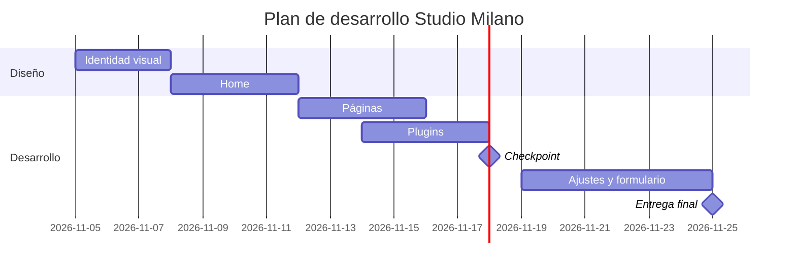

# Decisiones de mi sitio

**Emprendimiento:** Studio Milano
**Fecha:** 4 de noviembre de 2026
**Última corrección:** Pendiente

## 1. Plugins 

| # | Funcionalidad | Plugin | Gratis o de pago | Qué incluye la versión gratis | Probado hasta (WP) | Requiere PHP | ¿Funciona con tema propio? | Enlace a la ficha |
|---|---|---|---|---|---|---|---|---|
| 1 | SEO | Yoast SEO | Gratis y de pago | Optimización SEO y análisis de contenido | Verificar | Verificar | Sí | https://wordpress.org/plugins/wordpress-seo/ |
| 2 | Contacto | Contact Form 7 | Gratis | Creación de formularios de contacto | Verificar | Verificar | Sí | https://wordpress.org/plugins/contact-form-7/ |
| 3 | Estadísticas | Site Kit by Google | Gratis | Estadísticas de visitas y rendimiento | Verificar | Verificar | Sí | https://wordpress.org/plugins/google-site-kit/ |
| 4 | Copias de seguridad | UpdraftPlus | Gratis y de pago | Copias de seguridad y restauración | Verificar | Verificar | Sí | https://wordpress.org/plugins/updraftplus/ |
| 5 | Seguridad | Wordfence Security | Gratis y de pago | Protección y análisis de seguridad | Verificar | Verificar | Sí | https://wordpress.org/plugins/wordfence/ |

## 2. Páginas de la fase 1 

| # | Página | Por qué la elijo |
|---|---|---|
| 1 | Inicio | Para presentar Studio Milano y mostrar su identidad. |
| 2 | Contacto | Para facilitar la comunicación con los clientes. |
| 3 | Servicios | Para mostrar los diferentes servicios de uñas disponibles. |
| 4 | Blog | Para compartir consejos, cuidados y tendencias de uñas. |
| 5 | Tienda | Para mostrar productos, fotografías, características y precios. |

**Páginas que dejo para después:**
- Preguntas frecuentes.
- Términos y condiciones.
- Política de privacidad.
- Carrito de compras.
- Página de confirmación de compra.

## 3. Plan del tema 

- **Nombre del tema:** Studio Milano.
- **Custom o descargado:** Personalizado (Custom), porque quiero que tenga un diseño propio y represente la identidad del emprendimiento.

### Carta Gantt

| Etapa | Desde | Hasta | Notas |
|---|---|---|---|
| Identidad visual | 5 nov. | 7 nov. | Definir colores, tipografías y estilo. |
| Home | 8 nov. | 11 nov. | Diseñar y desarrollar el inicio. |
| Páginas | 12 nov. | 15 nov. | Crear las páginas principales. |
| Plugins | 14 nov. | 17 nov. | Instalar y configurar los plugins. |
| Checkpoint | 18 nov. | 18 nov. | Revisar los avances. |
| Ajustes y formulario | 19 nov. | 24 nov. | Corregir errores y probar el formulario. |
| Entrega final | 25 nov. | 25 nov. | Presentar el sitio terminado. |

Incluye también este diagrama Mermaid:

## 4. Plan B 

| Riesgo | Qué hago | Cuándo se activa (fecha o señal) |
|---|---|---|
| El tema propio no funciona o se rompe. | Revisar el código, corregir los errores y recuperar una copia de seguridad. Si no se soluciona, utilizar un tema gratuito de WordPress. | Cuando el diseño no se visualice correctamente o aparezcan errores. |
| Un plugin falla o no es compatible. | Desactivar el plugin que presenta problemas y buscar otro que cumpla la misma función. | Cuando el sitio presente errores después de instalar o actualizar un plugin. |
| No alcanzo a terminar todas las páginas. | Organizar nuevamente las tareas y priorizar las páginas obligatorias: Inicio y Contacto. Las demás se terminarán después. | Si al 18 de noviembre todavía faltan páginas por desarrollar. |
| El formulario de contacto no funciona. | Revisar su configuración, realizar nuevas pruebas y utilizar WhatsApp como medio de contacto alternativo. | Cuando los mensajes de prueba no lleguen correctamente. |
